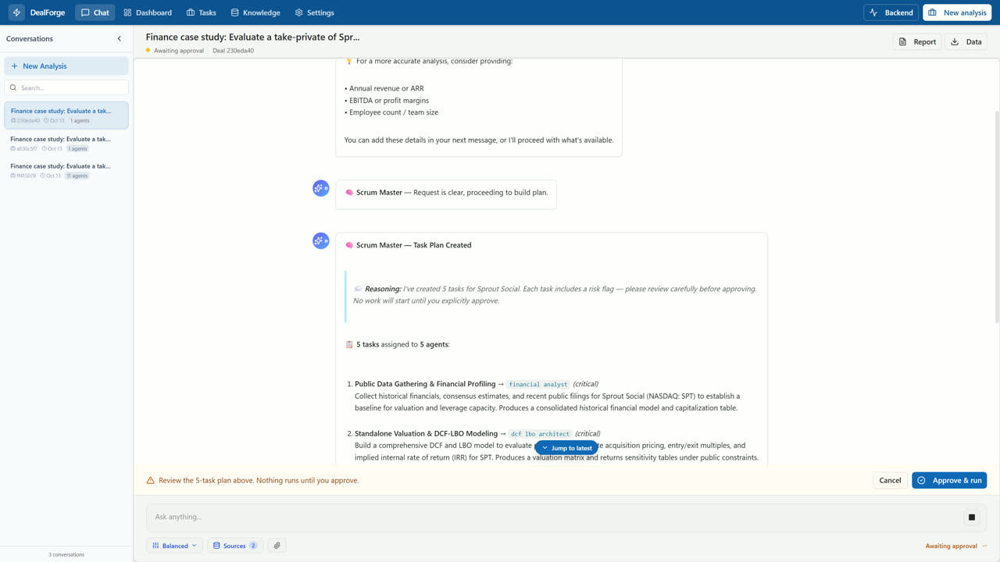

# DealForge AI

Multi-agent M&A deal analysis. Describe a deal in chat; a Scrum Master agent plans the work, you approve the plan, specialist agents run against real filings and market data, the system checks its own numbers, and you get a brief plus Word, PowerPoint, Excel and PDF drafts that a human has to approve for release.

**Project site, docs and demo videos: https://arpanguria68-ui.github.io/dealforge-ai/**

[](https://arpanguria68-ui.github.io/dealforge-ai/#demo)

*Click the image for the demo videos on the project site.*

## What it does

- **Plan first, human approved.** Clarifying questions (max three rounds, skippable) → dependency-ordered task plan → explicit approve. You can edit, add and reorder tasks on the Task Board.
- **29 specialist agents** (financial analysis, valuation, DCF/LBO, legal, risk, red team, ESG, tax, treasury, integration and more), each limited to its own tool allow-list.
- **39 tools**: SEC EDGAR XBRL filings, Finnhub, Alpha Vantage, financial_datasets, web search, DCF / LBO / sensitivity / Monte Carlo engines, diligence scanners, document builders, read-only MCP servers.
- **Shared, sourced valuation inputs.** A valuation agent builds WACC, growth, FCF and market EV from filings; DCF and LBO agents start from the same assumptions. A deterministic LBO and DCF-bridge repair back them up.
- **It checks its own work.** Memo figures are matched to recorded evidence, DCFs are compared across agents (flagged above 15% gap), unusable model replies are rejected and retried.
- **Document RAG with PageIndex.** Uploaded deal documents become a section tree (vectorless, no vector DB). Hybrid tree + BM25 + dense search with rank fusion and optional Laya rerank, scoped to the active deal, plus a per-deal knowledge graph. See the [Knowledge & RAG docs](https://arpanguria68-ui.github.io/dealforge-ai/docs/knowledge-and-rag.html).
- **Reports with a review gate.** Word, PowerPoint, Excel and PDF built from an evidence brief; unapproved reports download only as `_DRAFT_not_approved`.
- **Dashboard** with valuation vs market EV, sourcing and tool-call counters, review flags and the exact reconciliation warnings.
- **Any model.** Local-first routing with cloud fallback: Gemini, Claude, OpenAI, Mistral, Groq, OpenRouter, NVIDIA, Vertex, Ollama, LM Studio or any OpenAI-compatible endpoint. The Laya classifier layer routes tasks by complexity and shortlists tools, and fails soft.

## Quick start

Requirements: Python 3.11+, Node 20+, Redis 7, and one LLM provider (cloud key, local model, or OpenAI-compatible endpoint).

```bash
git clone https://github.com/arpanguria68-ui/dealforge-ai.git
cd dealforge-ai
```

### Docker Compose

```bash
cp .env.docker.example .env.docker      # add at least one provider key
docker compose --env-file .env.docker up --build -d
```

UI: http://localhost:3000, API: http://localhost:8005 (OpenAPI at `/docs`).

### Local development

```bash
redis-server                                   # terminal 1

cd backend                                     # terminal 2
python -m venv .venv && source .venv/bin/activate   # Windows: .venv\Scripts\activate
pip install -r requirements.txt
cp ../.env.example .env                        # add keys
python -m uvicorn app.main:app --host 127.0.0.1 --port 8005

cd frontend                                    # terminal 3
npm install && npm run dev
```

Redis is required (deals, conversations and generated artifacts live there). Keys can also be set in the app under Settings. Never commit `.env` or `settings.json`.

### First run

Open Chat → New Analysis and enter, for example: *Evaluate a take-private of Sprout Social (NASDAQ: SPT). Proceed with public data only; do not ask clarifying questions.* Review the plan, click **Approve & run**, then open the Dashboard and use **View Analysis → Generate** for the documents.

## Repository layout

| Path | Contents |
|---|---|
| `backend/app/agents` | 29 agents and `BaseAgent` (tool loop, validation, reflection) |
| `backend/app/core` | tools, LLM router and gateway, Laya, memory and search, reports, validation, LBO and valuation inputs |
| `backend/app/orchestrator` | LangGraph deal orchestrator (less exercised than the chat pipeline) |
| `backend/tests` | ~450 tests, including the agent harness contracts |
| `frontend/src` | React 19 + TypeScript UI: chat, dashboard, task board, knowledge base, settings |
| `website` | Source of the GitHub Pages site (`python website/tools/build_site.py` regenerates it) |
| `docs` | design notes and audits, e.g. `AGENTIC_HARNESS_AUDIT.md` |

## Tests

```bash
cd backend && pytest -q
```

Two tests fail on Windows only (symlink permission, hard-coded Windows paths). Deterministic contract tests cover tools, agent allow-lists, the tool loop and reports; there is no real-model benchmark yet.

## Status and limits

The interactive chat pipeline (clarify → plan → approve → execute → memo → brief → documents) is verified end to end on a real company. The LangGraph orchestrator, OFAS missions, debate engine and specialist workflows are implemented but less exercised. Redis is required, the app is single-tenant, agent confidence is model-reported and uncalibrated, and the memo recommendation is a labelled draft. See the [status page](https://arpanguria68-ui.github.io/dealforge-ai/docs/status.html).

## Disclaimer

DealForge produces analysis drafts, not investment advice. Outputs must be reviewed by qualified people before any decision.
